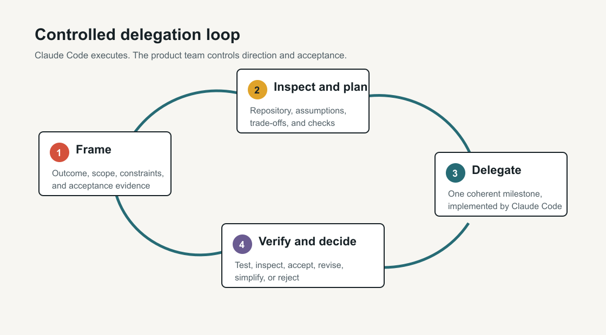

# Direct Claude Code as a PM

Claude Code can inspect a repository, edit files, run commands, test behavior,
and explain its work. That makes it useful for much more than code completion.
It can carry a product from brief to working prototype, provided that a human
sets the direction and checks the result.

The role of the PM is therefore not to relay prompts. It is to define value,
provide context, choose trade-offs, review evidence, and decide when the product
is ready to show.

## Keep Product Ownership Human

Claude Code can propose a stack, generate an interface, add persistence, write
tests, and diagnose failures. It cannot independently establish that:

- the selected problem matters to real users;
- the scope reflects stakeholder priorities;
- an interaction is understandable or useful;
- generated code is secure, lawful, maintainable, or correct;
- a passing test represents the intended product behavior;
- the application is ready to become a Capstone.

Treat every generated change as a proposal until you have reviewed it against
the available product, user, and technical evidence.

## Use a Controlled Delegation Loop



Use the same loop for each meaningful milestone:

1. **Frame:** state the user, desired outcome, constraints, and acceptance
   evidence.
2. **Ask for inspection:** let Claude Code examine the existing files before it
   proposes a solution.
3. **Review the plan:** question scope, assumptions, dependencies, and risky
   shortcuts before implementation.
4. **Delegate:** ask Claude Code to implement one coherent milestone.
5. **Verify:** require relevant checks, then exercise the result as a user.
6. **Decide:** accept, revise, simplify, or revert the proposal and record the
   reason when the decision matters.

Large one-shot prompts hide mistakes. Reviewable milestones make it easier to
see when Claude Code has misunderstood the product or changed something outside
the agreed scope.

## Give the Project Persistent Context

Claude Code reads project instructions from `CLAUDE.md`. A useful file is short,
specific, and maintained as the project evolves. Use the starter
[`CLAUDE.md`](CLAUDE.md) to define:

- the product outcome and target user;
- the core journey and explicit non-goals;
- the current architecture and important files;
- run, test, lint, and build commands;
- design, accessibility, data, and security constraints;
- completion and verification expectations.

Do not turn `CLAUDE.md` into a transcript or an enormous specification. Put the
stable operating rules there; keep the evolving product scope in
[`PRODUCT_BRIEF.md`](PRODUCT_BRIEF.md).

Anthropic recommends documenting common commands, code style, repository
structure, testing expectations, and repository-specific conventions. See the
official [`CLAUDE.md` guidance](https://code.claude.com/docs/en/memory).

## Prompt for Outcomes and Evidence

Weak request:

```text
Make the app better and add a dashboard.
```

Reviewable request:

```text
Inspect the current product brief and application. Propose the smallest change
that lets the target user complete [journey] without assistance. Before editing,
list the files you expect to change, assumptions that need confirmation, and
acceptance checks. After implementation, run the relevant checks and report
what remains unverified. Do not add features outside this journey.
```

The second request gives Claude Code a product outcome, a scope boundary, a
planning checkpoint, and an evidence standard. It still leaves room for Claude
Code to make useful implementation decisions.

## Verify at Three Levels

| Level | Question | Example evidence |
|---|---|---|
| Technical | Does the implementation run correctly? | Build, lint, type checks, automated tests |
| Journey | Can a user complete the intended flow? | Manual walkthrough, browser test, edge cases |
| Product | Does the flow solve the stated problem clearly? | Acceptance criteria, peer feedback, observed friction |

Claude Code should run the technical checks it can access. Humans still need to
inspect the interface, challenge misleading success claims, and decide whether
the journey communicates the intended value.

Passing tests are evidence, not proof. A polished screen with no working core
journey is not a successful prototype either.

## Protect the Project

- Review commands before granting permission, especially destructive or
  irreversible actions.
- Keep secrets in ignored environment files and provide only safe placeholders
  in `.env.example` when configuration is required.
- Use synthetic or public data unless an explicitly approved environment and
  policy allow something else.
- Ask Claude Code to explain unfamiliar dependencies before accepting them.
- Inspect the final diff and repository status before publishing.
- Never describe generated or mocked behavior as a validated production result.

The [Claude Code security documentation](https://code.claude.com/docs/en/security)
explains its permission model and recommended safeguards.

## Check Your Understanding

**Question:** Claude Code implemented the requested feature and reports that all
tests pass. Is the milestone complete?

<details><summary>Show solution</summary>

Not automatically. Confirm that the tests cover the acceptance criteria,
exercise the user journey, inspect the generated changes, check edge cases and
accessibility, and record any remaining uncertainty. Decide whether the evidence
is sufficient.

</details>

## Further Reading

- [Anthropic: Claude Code Best Practices](https://code.claude.com/docs/en/best-practices)
- [Anthropic: Common Claude Code Workflows](https://code.claude.com/docs/en/common-workflows)
- [Anthropic: Data Usage](https://code.claude.com/docs/en/data-usage)
