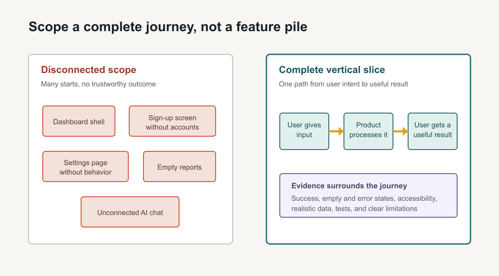
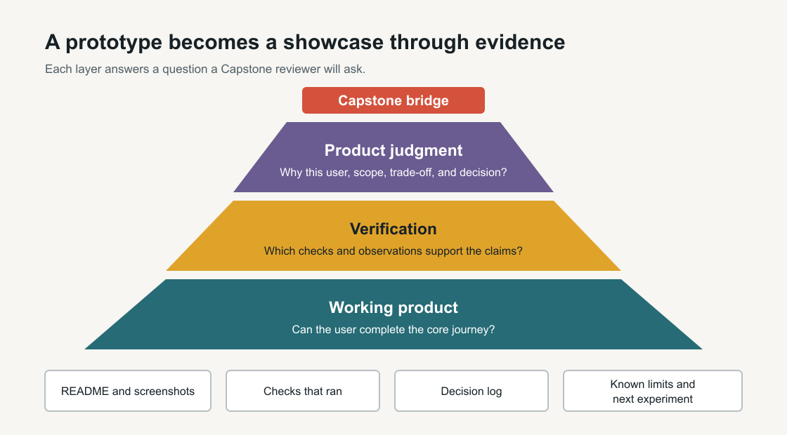

# Project Handout: Build a Capstone Preview with Claude Code

## Your Assignment

Act as the PMs for a small software product. Choose an original problem, define
one valuable user journey, and direct Claude Code to build a working application
that demonstrates it.

This is a preview of the later Capstone, not the Capstone itself. The project
should show that your team can turn a product decision into working software,
verify the result, and communicate what deserves further investment.

Claude Code should perform most of the implementation work. Your team remains
responsible for the problem, priorities, acceptance decisions, safety, and the
truthfulness of the final showcase.

## Choose a Product Worth Showing

Do not select from a fixed list of app ideas. Start from a context your team
understands and a user problem you can explain credibly. It may relate to work,
daily life, public services, communities, learning, sustainability, operations,
or another domain.

A suitable idea has:

- a specific user rather than "everyone";
- a recurring task, frustration, or decision;
- one visible outcome that software can improve;
- a safe way to demonstrate it with synthetic, seeded, or public data;
- enough room to evolve into a more ambitious Capstone direction.

Avoid generic clones whose only goal is to reproduce a familiar interface.

## Scope One Complete Vertical Slice

Build one complete path through the product rather than several disconnected
screens. Depending on the idea, the slice might include input, validation,
processing, persistence, feedback, and a useful result.

The core scope should contain:

- one primary user;
- one problem statement;
- one end-to-end journey, with a second only when it is essential;
- a clear success state and at least one failure or empty state;
- enough realistic content or data to make the demonstration understandable;
- a responsive, accessible interface appropriate to the use case.

You may accept the stack Claude Code recommends after reviewing its reasoning.
Prefer familiar, lightweight technologies and avoid paid services or complex
infrastructure unless they are essential to the product hypothesis.

## Phase 1: Frame the Product

Complete [`PRODUCT_BRIEF.md`](PRODUCT_BRIEF.md) before asking for
implementation. Claude Code may challenge and improve the draft, but the first
version must express your own product reasoning.

Confirm the following:

- Who is the user, and what situation are they in?
- What can they accomplish after using the product?
- What is the smallest journey that demonstrates this value?
- What evidence will show that the journey works?
- What is explicitly outside the mini-project?
- Which assumptions would need real user research later?

Ask Claude Code to identify ambiguity, hidden complexity, risky assumptions,
and opportunities to reduce scope. Decide which suggestions to accept.

## Phase 2: Configure Claude Code

Adapt [`CLAUDE.md`](CLAUDE.md) to the product. Give Claude Code
enough freedom to implement, but enough context to avoid repeatedly guessing
the objective and quality bar.

Before building, ask Claude Code to:

1. inspect the brief and starter workspace;
2. propose the simplest credible stack and architecture;
3. explain major trade-offs and dependencies;
4. divide the work into demonstrable milestones;
5. define the checks that will prove each milestone works.

Review the proposal. Remove unnecessary infrastructure and features before
authorizing implementation.

## Phase 3: Delegate in Milestones

Use the frame, inspect, plan, delegate, verify, and decide loop from the first
module. A useful milestone sequence is:

1. runnable product shell and visual direction;
2. complete core journey using realistic sample data;
3. persistence or external integration only if it strengthens the journey;
4. empty, error, loading, and mobile states;
5. automated checks and a realistic journey walkthrough;
6. showcase documentation and final polish.

Claude Code may edit files, run checks, and debug failures. Do not manually take
over implementation at the first problem. Give the error and observed behavior
back to Claude Code, ask it to investigate the cause, and review the proposed
fix.

Record important scope, architecture, dependency, and quality decisions in
[`DECISIONS.md`](DECISIONS.md). Keep entries concise; a full
prompt transcript is not required.

## Phase 4: Review as a Product Team

Do not ask only whether the code works. Review the product from several
perspectives:

- **Target user:** Is the next action obvious? Is the result understandable?
- **Product:** Does every core feature support the stated outcome?
- **Quality:** What happens with empty, invalid, repeated, or unexpected input?
- **Accessibility:** Can the experience be navigated and understood without
  relying only on color, hover, or perfect vision?
- **Trust:** Are generated, estimated, mocked, or unverified outputs identified?
- **Operations:** Can another person install, run, and demonstrate the app?
- **Security and privacy:** Are secrets excluded and is demonstration data safe?

Ask Claude Code to perform a final critical review and fix confirmed issues.
Check its claims yourself and keep unresolved limitations visible.

## Phase 5: Package the Showcase

Complete [`SHOWCASE.md`](SHOWCASE.md) and make the repository's
`README.md` useful to someone who was not present during development.

The showcase must include:

1. **Product story:** user, problem, value, and deliberate scope.
2. **Working demonstration:** one uninterrupted end-to-end journey.
3. **Product evidence:** acceptance criteria and feedback or observations.
4. **Technical evidence:** setup instructions and checks that actually ran.
5. **Claude Code collaboration evidence:** one example where Claude Code
   accelerated the work and one where human review changed its proposal.
6. **Capstone bridge:** what would require research, stronger data, architecture,
   testing, or governance before this became a serious Capstone candidate.

Include at least two clear screenshots or a short recorded demonstration. Do
not expose API keys, personal data, private URLs, or generated claims presented
as real user evidence.

## Required Deliverables

- A working application in this repository.
- A product `README.md` with purpose, screenshots, setup, run, and verification
  instructions.
- A completed `PRODUCT_BRIEF.md` and project-specific `CLAUDE.md`.
- A concise `DECISIONS.md` containing the decisions that shaped the result.
- A completed `SHOWCASE.md` connecting the mini-project to the later Capstone.
- Evidence that the core journey and relevant technical checks were completed.
- A live product demonstration and short team reflection.

## Quality Gate

The core project is complete only when:

- a new reviewer can explain the user and product value;
- the core journey works from a clean start;
- setup and run instructions have been followed by someone other than their
  author;
- loading, empty, error, and narrow-screen behavior have been reviewed where
  relevant;
- generated changes and dependencies have been inspected;
- the repository contains no secrets or sensitive demonstration data;
- test and build claims match checks that actually ran;
- known limitations and unverified assumptions are stated honestly;
- the showcase explains what should and should not carry into the Capstone.

## Optional Extensions

Complete these only after the quality gate passes. Choose extensions that deepen
the product evidence rather than adding unrelated features.

- Conduct short usability tests and use Claude Code to synthesize anonymized
  observations into prioritized changes.
- Add a second user role whose journey genuinely changes the product model.
- Replace seeded data with a well-documented public API or dataset and add a
  resilient fallback.
- Add persistent storage, migrations, and a reset path for demonstrations.
- Add authentication and authorization when identity is central to the use
  case, including negative permission tests.
- Add automated browser tests for the core journey and important failure paths.
- Add accessibility checks and resolve the confirmed issues.
- Add observability for meaningful failures, latency, or product events.
- Create and compare two interface variants against explicit evaluation
  criteria.
- Ask Claude Code for an architecture and security review, verify the findings,
  and resolve the highest-value issues.
- Deploy a preview and verify it on desktop and mobile without exposing secrets.
- Prepare a Capstone proposal covering research questions, success measures,
  data needs, architecture evolution, risks, and the next product experiment.

## Evaluation

| Area | Strong evidence |
|---|---|
| Product focus | A specific user and coherent journey drive the scope. |
| Direction of Claude Code | Context and milestones lead to reviewable work rather than uncontrolled generation. |
| Working result | The application runs and the core journey succeeds reliably. |
| Human judgment | Decisions, corrections, trade-offs, and rejected suggestions are visible. |
| Verification | Product and technical claims are supported by checks and observations. |
| Showcase quality | The story is clear, honest, visual, and relevant to a future Capstone. |

## Reflection

- Which product decision had the greatest effect on implementation?
- Where did Claude Code make a convincing but incorrect or unsuitable proposal?
- Which evidence gives you confidence in the result, and what remains unknown?
- What would you preserve, redesign, or investigate before using this direction
  for the Capstone?
