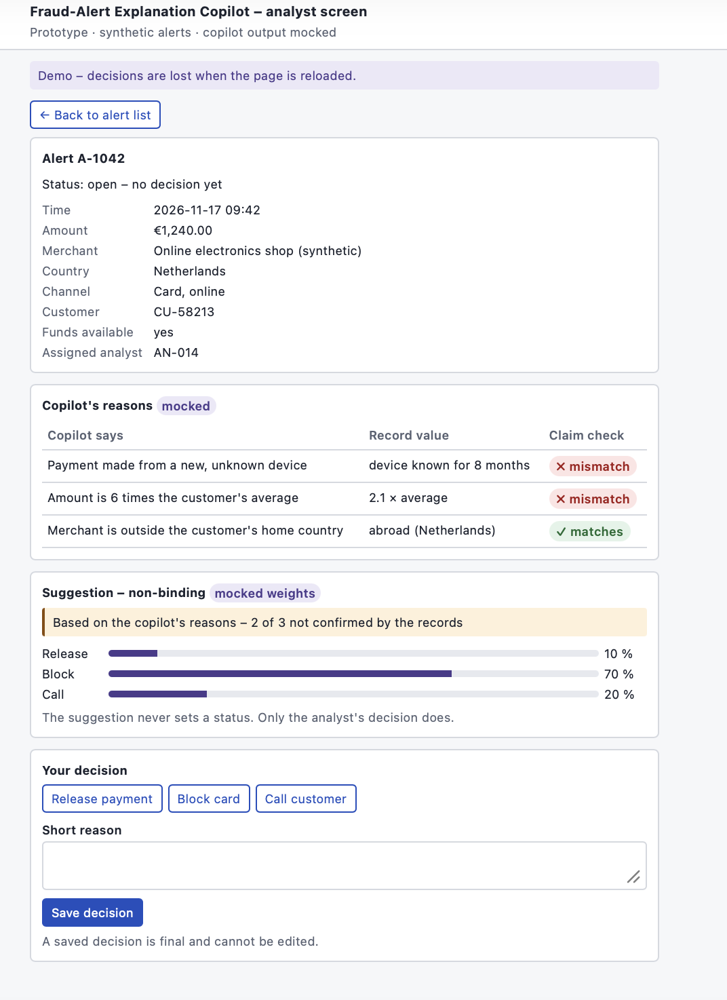
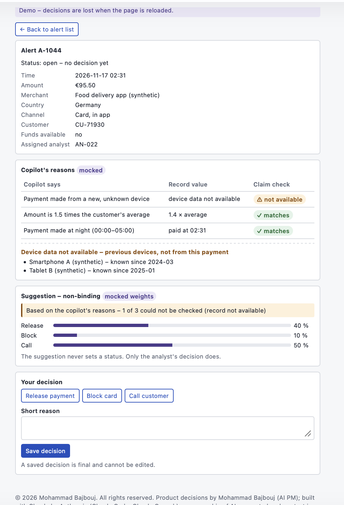

# Fraud-alert claim check – analyst screen prototype

A one-screen prototype that checks an AI copilot's reasons against the records before a fraud analyst decides.
Author: Mohammad Bajbouj (AI PM = AI product manager) · neuefische AI PM bootcamp, week 13 vibe coding project.

> **Disclaimer:** all data is **synthetic**. The copilot's reasons and the suggestion weights are **mocked** (pre-written, no real AI model). The app is **not connected to any bank system**.

## Product story

- **User:** a fraud analyst in a bank's fraud operations team (D10).
- **Problem:** the analyst can't see whether the copilot's reasons are supported by the records. In the synthetic case A-1042, the copilot said "new, unknown device" and "6 times the average", but the records showed a device known for 8 months and about 2 times. A genuine customer's card was blocked (D11, D12).
- **Value:** one screen shows the alert, each copilot reason checked against its record value (✓ matches / ⚠ not available / ✗ mismatch) and a non-binding suggestion. Only the analyst's click decides (D12, D14).
- **Deliberate scope:** one journey from alert list to saved decision with 3 synthetic alerts. Non-goals: login, a card-owner version, balance amounts, real bank systems, a real AI model, a database, real notifications (D16).

Details: [PRODUCT_BRIEF.md](PRODUCT_BRIEF.md). "D" numbers (D10, D12 …) refer to entries in the project's decision log.

## Screenshots


*Alert A-1042: two of the copilot's three reasons don't match the records (✗), and the warning line says so above the mocked weights.*


*Alert A-1044: device data is missing (⚠), so the customer's previous devices are listed for comparison. They're labelled "not from this payment" and aren't matched.*

## Open the app (no install)

Download or open [`index.html`](index.html) in any browser. **No Python and no internet are needed**: the file is self-contained and works offline.

## Demo path in 5 steps

1. In the alert list, click **Open** on **A-1042**.
2. Look at the claim check: "new, unknown device" and "6 times the average" both show **✗ mismatch** next to the record values.
3. Click **Block card** (it shows "✓ Block card") and type a short reason, e.g. "device is known – check with customer".
4. Click **Save decision**. The screen shows "Decision saved" and the status **⊘ card blocked**, and the alert is marked done in the list.
5. Decide A-1043 and A-1044 the same way. The list then shows **"No open alerts – all alerts are decided"**, and the decided alerts stay viewable, read-only (D37).

Reloading the page resets the demo: decisions are not stored (D24).

## Rebuild and test (developers)

You only need this if you change the data, the rules or the page template.

1. Check Python: `python3 --version` (3.9 or newer; standard library only, nothing to install). On Windows, use `py` or `python` instead of `python3` in all commands below.
2. Open a terminal in the project folder (the folder that contains `README.md`).
3. From the **repo root**, **build first**: `python3 app/build.py`
4. Then **test**: `python3 -m unittest discover -s tests -v`

`index.html` is generated: **never edit it by hand**. Change the files in `app/` and rebuild.

## Own phone test (optional, Mac)

This shares **only a folder containing `index.html`** on your Wi-Fi, never the repo:

```
mkdir -p /tmp/fraud-demo && cp index.html /tmp/fraud-demo/ && python3 -m http.server 8000 --directory /tmp/fraud-demo
```

- On the phone, open `http://<Mac IP>:8000/index.html`. The phone must be on the **same Wi-Fi**. The Mac's IP address is shown by `ipconfig getifaddr en0`.
- macOS may ask whether Python may accept incoming connections. Allow it only for this test.
- Press Ctrl + C to stop. After a rebuild, run the command again so the folder gets the new `index.html`.

## How it works – file map

```
app/data/alerts.json   →  app/claim_check.py         →  app/build.py + app/template.html  →  index.html
(3 synthetic alerts)      (claim-check rules, D19 –      (renders every screen)              (the app)
                           the only place they exist)
```

- Claim-check rules (D19): yes/no fact different from the record = ✗; a number more than 25 % away from the record = ✗; record missing = ⚠; otherwise ✓.
- The JavaScript in the page only handles clicks and keeps decisions in memory.
- Test: `tests/test_claim_check.py` checks the rules and the generated `index.html`.

## Verification – what actually ran

| Check | Who | Result |
|---|---|---|
| Automated tests | Claude Code | **22 tests pass**: run on 2026-11-18, Python 3.9.6, Mac |
| Clean-start run: copy without `index.html`, build + test with only the `CLAUDE.md` commands | Claude Code | Build OK, 22 tests pass, generated `index.html` byte-identical to the repo's, no external requests (2026-11-18) |
| Manual journey test (all 3 alerts, error messages, empty list, phone width) | Mohammad (AI PM), on the Mac and on an own phone | Passed (D40) |
| Keyboard (Tab) check on the alert list and alert screen | Mohammad (AI PM) in **Safari** | Passed (D44). Chrome did not open on the Mac, a deviation from the planned Chrome test (D9). |
| Independent review of the product brief + 2 screenshots | Gemini (Google) | Done (M4.2); findings handled in D46–D47 |
| Setup test of this README by a reader who wasn't involved | Gemini (Google) | **2026-11-18: 5 × yes, 2 × partly – both fixed (D59)** |

## Known limitations

- **Weights are fixed and mocked.** A-1042 still suggests "Block 70 %" although 2 of 3 reasons are not confirmed (D46). A real weighting method is a Capstone question.
- **"Decided by" shows the assigned analyst ID, not who clicked**, because there's no login (D48, D11).
- **Decisions are lost on reload**: there's no database (D24, D16).
- **The copilot's reasons are pre-written**: no real AI model is called (D16).
- **Not tested:** Windows, screen readers, Chrome on the Mac.
- **Open backlog:**
  - G1: reason field not marked "required";
  - R6: no "max. 200 characters" hint;
  - R7: focus after "Back", and small list buttons on phones;
  - no browser tab icon (D39, D47).

  G = finding from Gemini's review; R = finding from Claude Code's review.

## More

- [DECISIONS.md](DECISIONS.md): the key product and implementation decisions.
- [SHOWCASE.md](SHOWCASE.md): the showcase evidence and Capstone reflection.
- [CLAUDE.md](CLAUDE.md): project instructions for Claude Code.

License: see [LICENSE](LICENSE)

---
© 2026 Mohammad Bajbouj. All rights reserved. Product decisions by Mohammad Bajbouj (AI PM); app, tests and README drafted with Claude by Anthropic (Claude Code, Claude Cowork); reviewed by Gemini (Google); no ownership of AI-generated text or code is claimed. Practice project for the neuefische AI PM bootcamp. All data is synthetic – no real bank or customer data.
