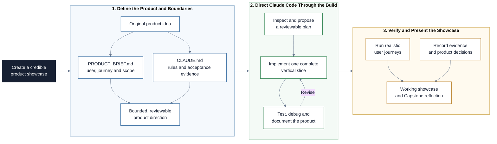

# Vibe Coding: Claude Code Product Showcase

This learning path is a rehearsal for the later Capstone. Use Claude Code to
turn an original product idea into a small, working application, then
demonstrate the product decisions, verification, and communication needed to
make Claude-generated software credible. Your objective is not to write the
most code, but to direct Claude Code well and remain accountable for what is
shipped.

## Project at a Glance

The project turns an original idea into one polished end-to-end product slice,
with Claude Code doing most implementation work and the AI PM owning decisions.

## Learning Objectives

By the end of this repository, you should be able to:

- Turn an open product opportunity into a narrow, testable user journey.
- Give Claude Code persistent project context through a focused `CLAUDE.md`.
- Delegate discovery, planning, implementation, testing, and documentation in
  reviewable steps.
- Inspect generated work and make evidence-based product decisions.
- Verify the application through realistic user journeys, not visual polish
  alone.
- Present a working product and its development evidence as a Capstone preview.

## Learning Path

The modules build on each other in order.

| File / Folder | Description |
|---|---|
| [**01 - Direct Claude Code**](01-direct-claude-code.md) | Learn the context, delegation, review, and verification loop used throughout the project. |
| [**02 - Project Handout**](02-project-handout.md) | Define, build, validate, and present an original product showcase. |

### Additional Folders and Files

| File / Folder | Description |
|---|---|
| [**CLAUDE.md**](CLAUDE.md) | Shared instructions that keep Claude Code aligned with the product and current milestone. |
| [**PRODUCT_BRIEF.md**](PRODUCT_BRIEF.md) | Working definition of the user, problem, journey, scope, and acceptance evidence. |
| [**DECISIONS.md**](DECISIONS.md) | Concise record of consequential product and implementation decisions. |
| [**SHOWCASE.md**](SHOWCASE.md) | Evidence and reflection connecting the mini-project to the later Capstone. |
| [**assets**](assets/) | Visual guides for scope, delegation, and Capstone-ready evidence. |
| [**LICENSE**](LICENSE) | MIT license for the repository. |

## Getting Started

No preconfigured Python environment or shared framework is required for this
repository.

1. Create a repository from this template and add collaborators when working
   in a group.
2. Clone the repository and open it through a Claude Code interface that can
   access the repository files.
3. Read the lesson and handout in numerical order.
4. Complete the product brief and adapt `CLAUDE.md` before implementation.
5. Use the decision log and showcase template as working documents throughout
   the project.

## Claude Code Collaboration Guidelines

Use Claude Code for most of the implementation work: inspecting the
repository, proposing a plan, creating the application, running checks,
debugging failures, and updating documentation. You remain accountable for the
problem, scope, priorities, product decisions, permissions, and final
verification. Never enter credentials or sensitive data. Review consequential
changes before accepting them, and record important suggestions that you
accepted, corrected, or rejected.

## References & Further Reading

- [Anthropic: Claude Code Overview](https://code.claude.com/docs/en/overview)
- [Anthropic: Claude Code Best Practices](https://code.claude.com/docs/en/best-practices)
- [Anthropic: How Claude Code Uses `CLAUDE.md`](https://code.claude.com/docs/en/memory)
- [Anthropic: Claude Code Security](https://code.claude.com/docs/en/security)
- [GitHub Docs: About READMEs](https://docs.github.com/en/repositories/managing-your-repositorys-settings-and-features/customizing-your-repository/about-readmes)
